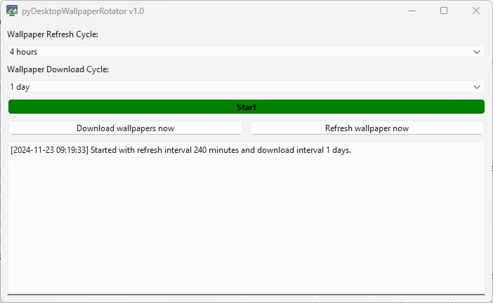

# pyDesktopWallpaperRotator
Simple python application that downloads daily wallpapers from Bing and rotates them on predefined time intervals.

# GUI layout

# Support
Found this project useful? Send your ❤ in any form you can 🙂. Please contact me if you donated and want to be added to the contributors list !

- chia XCH---xch1glz7ufrfw9xfp5rnlxxh9mt9vk9yc8yjseet5c6u0mmykq8cpseqna6494
